<picture>
  <source media="(prefers-color-scheme: dark)" srcset="assets/v4/profile-dark.svg">
  <source media="(prefers-color-scheme: light)" srcset="assets/v4/profile-light.svg">
  
</picture>

<a href="https://github.com/Nelpine?tab=repositories"><picture>
  <source media="(prefers-color-scheme: dark)" srcset="assets/v3/nav-repositories-dark.svg">
  <source media="(prefers-color-scheme: light)" srcset="assets/v3/nav-repositories-light.svg">
  
</picture></a>&nbsp;
<a href="https://github.com/Nelpine?tab=stars"><picture>
  <source media="(prefers-color-scheme: dark)" srcset="assets/v3/nav-stars-dark.svg">
  <source media="(prefers-color-scheme: light)" srcset="assets/v3/nav-stars-light.svg">
  
</picture></a>&nbsp;
<a href="https://github.com/Nelpine#js-contribution-activity"><picture>
  <source media="(prefers-color-scheme: dark)" srcset="assets/v3/nav-activity-dark.svg">
  <source media="(prefers-color-scheme: light)" srcset="assets/v3/nav-activity-light.svg">
  
</picture></a>&nbsp;

主要做 **Java 后端与 Web 应用开发**，使用 Spring 生态、Vue 和 TypeScript。

## 技术栈

项目中使用的技术与工具。

### <picture>  <source media="(prefers-color-scheme: dark)" srcset="assets/v3/section-backend-dark.svg">  <source media="(prefers-color-scheme: light)" srcset="assets/v3/section-backend-light.svg">  </picture> 后端开发

  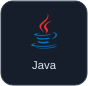&nbsp;
  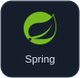&nbsp;
  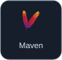&nbsp;

**框架与持久层**：Spring Boot · Spring Cloud · MyBatis · MyBatis-Plus  
**服务调用**：OpenFeign · Spring Cloud Gateway

### <picture>  <source media="(prefers-color-scheme: dark)" srcset="assets/v3/section-frontend-dark.svg">  <source media="(prefers-color-scheme: light)" srcset="assets/v3/section-frontend-light.svg">  </picture> 前端开发

  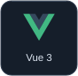&nbsp;
  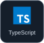&nbsp;
  &nbsp;
  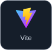&nbsp;
  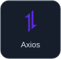&nbsp;
  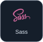&nbsp;

**应用开发**：Vue 3 · TypeScript · Vite · Axios  
**其他项目使用**：Vue Router · Vuex · Element UI · ECharts · Sass

### <picture>  <source media="(prefers-color-scheme: dark)" srcset="assets/v3/section-data-dark.svg">  <source media="(prefers-color-scheme: light)" srcset="assets/v3/section-data-light.svg">  </picture> 数据与中间件

  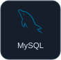&nbsp;
  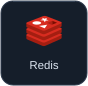&nbsp;
  &nbsp;

**存储与消息**：MySQL · Redis · Redisson · RabbitMQ  
**服务治理**：Nacos · Sentinel · Seata

### <picture>  <source media="(prefers-color-scheme: dark)" srcset="assets/v3/section-engineering-dark.svg">  <source media="(prefers-color-scheme: light)" srcset="assets/v3/section-engineering-light.svg">  </picture> 工程与交付

  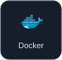&nbsp;
  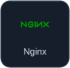&nbsp;
  &nbsp;
  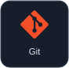&nbsp;
  &nbsp;
  &nbsp;
  &nbsp;

**构建与部署**：Maven · Docker Compose · Nginx · Linux · GitHub Actions  
**测试**：JUnit 5 · Testcontainers · Playwright

## GitHub 贡献热力图

<picture>
  <source media="(prefers-color-scheme: dark)" srcset="assets/contributions/calendar-dark.svg">
  <source media="(prefers-color-scheme: light)" srcset="assets/contributions/calendar-light.svg">
  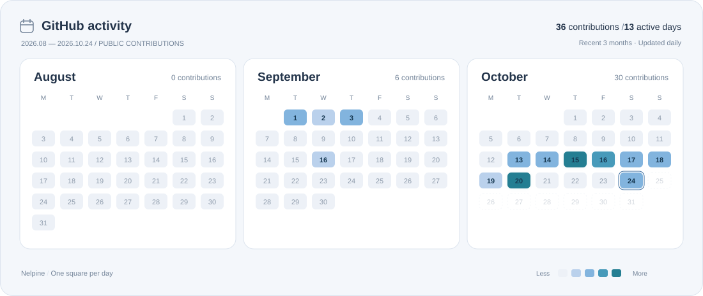
</picture>

最近三个月的公开贡献日历，每天自动刷新；颜色表示贡献次数，虚线方格表示未来日期。

---

Technology icons: <a href="https://github.com/devicons/devicon">Devicon</a> · <a href="assets/v3/DEVICON-LICENSE.txt">MIT License</a>
