<picture>
  <source media="(prefers-color-scheme: dark)" srcset="assets/forest-dark.svg">
  <source media="(prefers-color-scheme: light)" srcset="assets/forest-light.svg">
  
</picture>

  <a href="https://github.com/Nelpine?tab=repositories">Repositories · 代码仓库</a>
  &nbsp; / &nbsp;
  <a href="https://github.com/Nelpine?tab=stars">Stars · 灵感收藏</a>
  &nbsp; / &nbsp;
  <a href="https://github.com/Nelpine#js-contribution-activity">Activity · 开发足迹</a>

 

### 你好，我是 Nelpine 👋

把好奇写进代码，让想法慢慢生长。

专注 **Java 后端与 Web 开发**，在实践中学习，在迭代中完善。

Learning by building. One small step at a time.

 

### 🌱 正在探索 · Exploring

  &nbsp;
  &nbsp;
  &nbsp;
  

| 后端 · Backend | 应用 · Web | 日常 · Practice |
| :--- | :--- | :--- |
| 用 Java 与 Spring 理解服务如何运转 | 连接接口与页面，打磨完整体验 | 阅读、动手、复盘，积累每一次进步 |

 

> 好的代码，和树一样，需要耐心生长。 🌲

<picture>
  <source media="(prefers-color-scheme: dark)" srcset="assets/trail-dark.svg">
  <source media="(prefers-color-scheme: light)" srcset="assets/trail-light.svg">
  
</picture>
